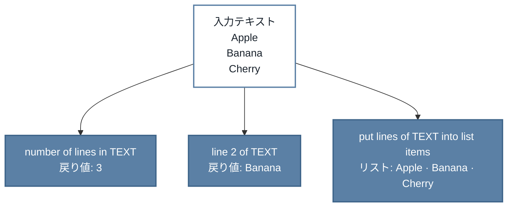

# TurboWarp-Text-Lines


[English](README.md) | 日本語

TurboWarpのプロジェクトで複数行テキストを扱います。Text Linesは次の3つのblockを追加します。

- テキストの行数を数える。
- 位置を指定して1行を取り出す。
- テキストの全行でScratchのリストを置き換える。

**ユーザーガイド:** [English](https://kubohiroya.github.io/turbowarp-text-lines/) · [日本語](https://kubohiroya.github.io/turbowarp-text-lines/ja/)

## クイックスタート

1. [`dist/text-lines.js`](dist/text-lines.js?raw=1)をダウンロードします。
2. **TurboWarp Desktop**で**拡張機能**を開き、**カスタム拡張機能**を選んで、ダウンロードしたファイルを読み込みます。
3. TurboWarpが確認したら**サンドボックス化せずに実行**を有効にします。

> [!IMPORTANT]
> Text Linesのcommand blockはScratchのリストへ直接書き込むため、サンドボックスなしで動作させる必要があります。

そのまま使えるJavaScriptファイルをこのリポジトリにcommitしてあります。インストールにNode.jsは要りません。

## 実行できるサンプル

[**TurboWarp EditorでLines to Listを開く**](https://turbowarp.org/editor?project_url=https%3A%2F%2Fkubohiroya.github.io%2Fturbowarp-text-lines%2Fsamples%2Flines-to-list.sb3) · [SB3をダウンロード](https://kubohiroya.github.io/turbowarp-text-lines/samples/lines-to-list.sb3)

拡張の確認画面で**Run without sandbox**を選んで**Allow**し、緑の旗を押します。
行数`3`、2行目`Banana`、リスト`Apple, Banana, Cherry`を表示します。
最初の`Input text`設定ブロックを編集して試せます。再実行時はリストを置き換えます。
検証対象の拡張JSと背景をSB3へ同梱しており、追加のJS取得は不要です。

元データは`samples/lines-to-list/`にあります。`pnpm run samples:build`で再生成し、
`pnpm run samples:check`で更新漏れを検査します。[保守方法](samples/README.md)も参照してください。

## 動かしてみる

次のテキストを入力とします。

```text
Apple
Banana
Cherry
```

同じテキストを、各blockが別々の使い方で扱います。



角の丸い2つのreporter blockは値を返します。command blockは選択したリストをその場で書き換えます。

## ブロック

### どのblockを使うか

| 目的 | block | 上の例での結果 |
|---|---|---|
| 全行を数える | `number of lines in [TEXT]` | `3` |
| 1行を読む | `line [LINE] of [TEXT]`（行に`2`を指定） | `Banana` |
| テキストをリストの項目にする | `put lines of [TEXT] into list [LIST]` | `Apple`、`Banana`、`Cherry` |

### block定義

正式な定義は[`src/block-definitions.json`](src/block-definitions.json)から生成します。

| block | 種別 | opcode | 動作 |
|---|---|---|---|
| `number of lines in [TEXT]` | Reporter | `lineCount` | 渡されたテキストの行数を返します。 |
| `line [LINE] of [TEXT]` | Reporter | `lineAt` | 1始まりの行番号で1行を返します。範囲外の行番号は空文字列を返します。 |
| `put lines of [TEXT] into list [LIST]` | Command | `writeLinesToList` | 指定したScratchリストの内容を、渡されたテキストの各行で置き換えます。 |

`TEXT`の既定値は`first line\nsecond line`、`LINE`の既定値は`1`、`LIST`は`LIST_MENU`から選びます。

## 重要な挙動

| 状況 | Text Linesの動作 |
|---|---|
| 行番号 | `0`ではなく`1`から数えます |
| 不正な行番号 | 空文字列を返します |
| 空のテキスト | 空行1行として扱います |
| 改行で終わるテキスト | 末尾に空行を1つ加えます |
| リストのcommand | 選択したリストの既存項目をすべて置き換えます |
| 改行コード | LF（`\n`）、CRLF（`\r\n`）、CR（`\r`）を受け付けます |

> [!WARNING]
> リストのcommandを実行する前に、残したい内容は控えておいてください。

図入りの例と日本語版は[ユーザーガイド](https://kubohiroya.github.io/turbowarp-text-lines/)にあります。

## 開発

Node.js 24以降で依存関係をインストールし、すべての検査を実行します。

```bash
npm install --global corepack@latest
corepack enable
pnpm install --frozen-lockfile
pnpm run check
```

よく使うコマンドです。

| コマンド | 用途 |
|---|---|
| `pnpm run dev` | ファイルの変更に追従して拡張機能を再ビルドする |
| `pnpm run test` | テストを1回実行する |
| `pnpm run typecheck` | TypeScriptの型を検査する |
| `pnpm run build` | `dist/text-lines.js`をビルドする |
| `pnpm run docs` | 正式な定義からblockの一覧を再生成する |

拡張機能のsourceを変更したら、再ビルドして[`dist/text-lines.js`](dist/text-lines.js)をcommitしてください。
block定義を変更したら、commit前に`pnpm run docs`を実行してください。

## リリース情報

このリポジトリの今後のライセンスのsource of truthはMPL-2.0です。この判断は、リポジトリのライセンス履歴、
Viteの拡張機能metadata、生成bundleのheaderに基づきます。公開済みのpackage versionは配布時の条件を維持し、
このリポジトリが過去の許諾を遡って取り消すことはありません。

package metadataのsource of truthは`package.json`です。`repo-policy.json`がリポジトリのpolicyを記録し、
`pnpm run check`がREADME、LICENSE、package metadata、生成された`dist/`、npm packageの内容を検証します。

## ライセンス

SPDX-License-Identifier: MPL-2.0

固定入力の編集範囲・互換性・切戻しについては[固定入力の編集](docs/fixed-input-editors.ja.md)を参照してください。
