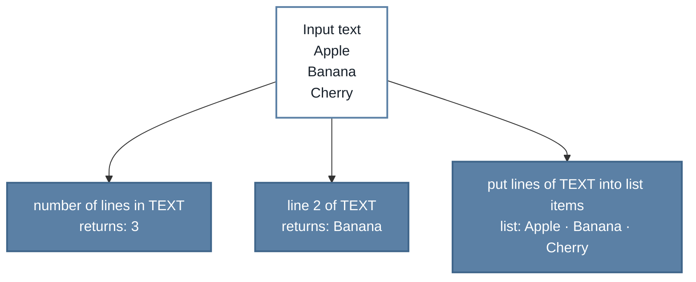

# TurboWarp-Text-Lines


English | [日本語](README.ja.md)

Use multiline text in TurboWarp projects. Text Lines adds four blocks that can:

- count the lines in some text;
- return one line by its position;
- return every line as a JSON array; and
- replace a Scratch list with every line from the text.

**User guide:** [English](https://kubohiroya.github.io/turbowarp-text-lines/) · [日本語](https://kubohiroya.github.io/turbowarp-text-lines/ja/)

## Quick start

1. Download [`dist/text-lines.js`](dist/text-lines.js?raw=1).
2. In **TurboWarp Desktop**, open **Extensions**, choose **Custom Extension**, and load the downloaded file.
3. Enable **Run without sandbox** when TurboWarp asks.

> [!IMPORTANT]
> Text Lines needs to run without the sandbox because its command block writes directly to Scratch lists.

The ready-to-use JavaScript file is committed to this repository. You do not need Node.js to install the extension.

## Runnable sample

[**Open Lines to List in TurboWarp Editor**](https://turbowarp.org/editor?project_url=https%3A%2F%2Fkubohiroya.github.io%2Fturbowarp-text-lines%2Fsamples%2Flines-to-list.sb3) · [Download the SB3](https://kubohiroya.github.io/turbowarp-text-lines/samples/lines-to-list.sb3)

Allow the custom extension to load, choose **Run without sandbox**, and
click the green flag. The stage shows **Line count: 3**, **Second line: Banana**,
and a **Lines** list containing Apple, Banana, and Cherry. Running it again replaces
the list. The sample uses three Text Lines blocks and no other extensions.

The SB3 includes the tested Text Lines JavaScript so TurboWarp can offer the
unsandboxed permission checkbox. Reopening the downloaded SB3 needs no extra JS download.
Edit the first `set Input text` block to try other text.

Sources: [`samples/lines-to-list/project.json`](samples/lines-to-list/project.json).
Rebuild with `pnpm run samples:build`; check committed archives with
`pnpm run samples:check`. `pnpm run pages:build` stages documentation, `dist/`, and
samples under `_site/` for GitHub Pages. See [sample maintenance](samples/README.md).

## See it in action

Start with this text:

```text
Apple
Banana
Cherry
```

Each block uses the same text in a different way:



The rounded reporter blocks return a value. The command block changes the selected list immediately.

## Block reference

### Which block should I use?

| Goal | Block | Result for the example above |
|---|---|---|
| Count all lines | `number of lines in [TEXT]` | `3` |
| Read one line | `line [LINE] of [TEXT]` with line `2` | `Banana` |
| Get every line as JSON | `lines of [TEXT] as JSON` | `["Apple","Banana","Cherry"]` |
| Turn the text into list items | `put lines of [TEXT] into list [LIST]` | `Apple`, `Banana`, `Cherry` |

The exact block definitions are generated from [`src/block-definitions.json`](src/block-definitions.json):

<!-- BEGIN GENERATED BLOCKS -->

### `number of lines in [TEXT]`

Returns the number of lines in the supplied text.

<details>
<summary>Block metadata</summary>

| Property | Value |
|---|---|
| Type | Reporter |
| Opcode | `lineCount` |
| `TEXT` | String, default: `first line\nsecond line` |

</details>

### `line [LINE] of [TEXT]`

Returns one line using a one-based line number. Invalid line numbers return an empty string.

<details>
<summary>Block metadata</summary>

| Property | Value |
|---|---|
| Type | Reporter |
| Opcode | `lineAt` |
| `TEXT` | String, default: `first line\nsecond line` |
| `LINE` | Number, default: `1` |

</details>

### `lines of [TEXT] as JSON`

Returns every line as a JSON array of strings, with as many items as the line count.

<details>
<summary>Block metadata</summary>

| Property | Value |
|---|---|
| Type | Reporter |
| Opcode | `linesJson` |
| `TEXT` | String, default: `first line\nsecond line` |

</details>

### `put lines of [TEXT] into list [LIST]`

Replaces the contents of the named Scratch list with the lines of the supplied text.

<details>
<summary>Block metadata</summary>

| Property | Value |
|---|---|
| Type | Command |
| Opcode | `writeLinesToList` |
| `TEXT` | String, default: `first line\nsecond line` |
| `LIST` | String, menu: `LIST_MENU` |

</details>

<!-- END GENERATED BLOCKS -->

## Important behavior

| Situation | What Text Lines does |
|---|---|
| Line numbers | Starts counting at `1`, not `0` |
| Invalid line number | Returns an empty string |
| Empty text | Treats it as one empty line |
| Text ending with a line break | Adds an empty final line |
| List command | Replaces all existing items in the selected list |
| JSON block | Splits exactly like the other blocks, so the array always has as many items as `number of lines in [TEXT]` |
| Line endings | Accepts LF (`\n`), CRLF (`\r\n`), and CR (`\r`) |

> [!WARNING]
> Copy any list contents you need to keep before running the list command.

## Use with TurboWarp Structured Data

`lines of [TEXT] as JSON` returns text that [TurboWarp Structured Data](https://github.com/kubohiroya/turbowarp-structured-data)
can read directly, so its `for each` block can walk the lines:

```text
parse JSON (lines of [TEXT] as JSON) as [lines]
for each in [lines] at path [$] max [100]
```

One loop handles up to 1,000 items, and Structured Data accepts JSON text up to 256 KiB. For longer text,
use `put lines of [TEXT] into list [LIST]` and Scratch's own list blocks instead.

For illustrated examples and the Japanese version, open the [complete user guide](https://kubohiroya.github.io/turbowarp-text-lines/).

## Development

Install dependencies with Node.js 24 or later and run every check:

```bash
npm install --global corepack@latest
corepack enable
pnpm install --frozen-lockfile
pnpm run check
```

Useful commands:

| Command | Purpose |
|---|---|
| `pnpm run dev` | Rebuild the extension while files change |
| `pnpm run test` | Run the test suite once |
| `pnpm run typecheck` | Check TypeScript types |
| `pnpm run build` | Build `dist/text-lines.js` |
| `pnpm run docs` | Regenerate the block reference from the canonical definitions |

When extension source changes, rebuild and commit [`dist/text-lines.js`](dist/text-lines.js). When block definitions change, run `pnpm run docs` before committing.

## Release metadata

MPL-2.0 is the forward license source of truth for this repository. The decision is based on the
repository license history, Vite extension metadata, and generated bundle header. Published package
versions keep the terms they were distributed with; this repository does not revoke earlier grants
retroactively.

`package.json` is the package metadata source of truth. `repo-policy.json` records the repository
policy, and `pnpm run check` verifies README, LICENSE, package metadata, generated `dist/`, and npm
package contents.

## License

SPDX-License-Identifier: MPL-2.0

固定入力の編集範囲・互換性・切戻しについては [固定入力の編集](docs/fixed-input-editors.ja.md) を参照してください。
